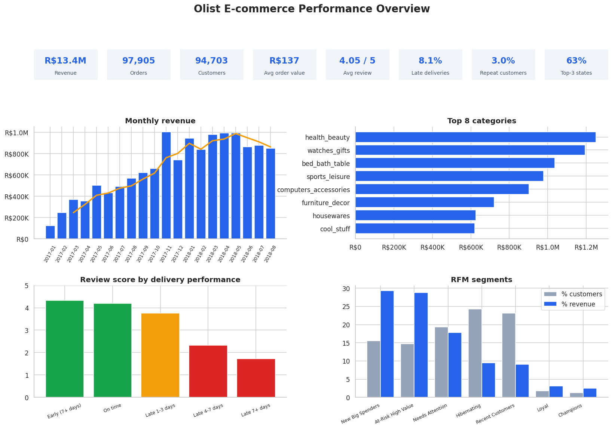

# Olist E-commerce Sales & Customer Behaviour Analysis

This repository contains my data analysis portfolio project, where I use SQL, Python and Power BI to find out where a Brazilian online marketplace makes its money, why customers get unhappy, and why they rarely come back.




## About the Project ❓

Olist is a Brazilian marketplace that connects small sellers to large online storefronts. The business questions are:

1. **Growth:** where is revenue coming from, and is growth healthy or just seasonal?
2. **Customer experience:** do late deliveries hurt customer satisfaction?
3. **Retention:** do customers come back, and which customers are worth winning back?

The project uses the Brazilian E-Commerce Public Dataset by Olist (99,441 orders across 8 relational tables, 2016 to 2018). SQL is the main analysis engine, and Python is used for cleaning, statistics and visualisation. The findings are then turned into prioritised business recommendations.

The aim of the project is to show a sound, reproducible analysis and honest conclusions, not just a set of charts.


## Environment 👩🏻‍💻

<p align="center">
  
  
  
</p>


## Stack 🛠️

<p align="center">
  
  
</p>

<p align="center">
  
  
  
  
  
</p>


## Methodology 🧪

| Stage | What I did |
|---|---|
| **Input** | 8 relational tables: customers, orders, order items, payments, reviews, products, sellers, category translations |
| **Data cleaning** | Audited missing values and duplicates, nulled impossible or inconsistent delivery dates, filled 610 missing product categories, deduplicated 547 orders with multiple reviews, and logged every decision |
| **Database** | Loaded the clean tables into SQLite and built three reusable views (`v_reviews_dedup`, `v_sales`, `v_delivered_orders`) that act like a small data warehouse |
| **Quality check** | Reconciliation test: the joined view matches the source tables on both row count (111,752 items) and revenue (R$13,449,530), so no join duplicates or drops data |
| **Business rules** | Revenue = item price (excluding freight); cancelled and unavailable orders excluded; analysis window 2017-01 to 2018-08 because 2016 and late 2018 are incomplete |
| **SQL analysis** | Multi-table joins, CTEs and window functions: `LAG`, `RANK`, `NTILE`, `ROW_NUMBER`, `FIRST_VALUE` and running totals |
| **Statistics** | Mann-Whitney U test, confidence interval and Cohen's d on late versus on-time review scores |
| **Visualisation** | 12 matplotlib and seaborn charts, plus a static executive dashboard |
| **Dashboard** | Power BI dashboard built from the exported tables (see `powerbi/POWERBI_GUIDE.md`) |

### Analyses
- **Analysis 1:** Monthly revenue and month-over-month growth (CTE + `LAG`)
- **Analysis 2:** Category performance and Pareto curve (running total window)
- **Analysis 3:** Geography and logistics by state (two CTEs joined)
- **Analysis 4:** Delivery performance versus review score, with a hypothesis test
- **Analysis 5:** Customer retention, cohort heatmap and first-delivery effect on repurchase
- **Analysis 6:** RFM customer segmentation (`NTILE` scoring)
- **Analysis 7:** Payments, seller concentration and order timing
- **Analysis 8:** Scenario model: the revenue at stake if late deliveries are reduced


## Results 📊

| Question | Method | Finding |
|---|---|---|
| Is growth healthy? | Monthly revenue, MoM and YoY growth | Revenue of R$13.4M across 97,905 orders. Jan to Aug 2018 is up 138% on the same months of 2017, driven by order volume (orders +177%, average order value -2%). Monthly revenue has plateaued at roughly R$0.85M to R$1.0M since Nov 2017 |
| Where does revenue come from? | Pareto analysis | 18 categories generate 80% of revenue (top category: health_beauty, 9.3%). SP alone is 38% of revenue and the top 3 states are 63%. The top 10% of sellers make 67% |
| Does late delivery hurt satisfaction? | Mann-Whitney U, Cohen's d | Late orders are 8.0% of orders but 34% of 1 and 2 star reviews. Mean gap of -1.73 stars (95% CI -1.77 to -1.69), Cohen's d = -1.21, p < 0.001. Orders 7+ days late get a 1 or 2 star review 78.5% of the time |
| Do slow regions suffer more? | State-level join of sales and logistics | The slowest states (RR, AP, AM) average 28 days versus 13 overall, with freight at 24% of revenue versus 16.6% overall. Delivery time and review score correlate at r = -0.46 |
| Do customers come back? | Cohort retention | 97.0% of customers place only one order; just 3.0% ever buy again |
| Does a bad first delivery matter? | `ROW_NUMBER` + repurchase rate | Repurchase rate is 3.04% after an on-time first delivery versus 2.50% after a late one |
| Who should we target? | RFM segmentation | 13,921 "At-Risk High Value" customers hold R$3.87M (29% of historic revenue); 14,715 "New Big Spenders" are recent, high-value buyers |
| Does payment method matter? | Payment analysis | Credit card is 78.5% of payment value. Orders paid in 7 to 10 instalments average R$332 versus R$134 for single payments |
| What is the prize for fixing delivery? | Scenario model | Halving late first deliveries adds only about 21 repeat orders (about R$2,800, a 0.02% uplift) |


## Key Takeaways 💡

- Late delivery is the clearest controllable driver of unhappy customers: only 8.0% of orders are late, yet they produce 34% of the 1 and 2 star reviews.
- Fixing delivery will protect ratings and reputation, but it will **not** solve retention on its own. The repurchase gap between on-time and late first deliveries is only 0.54 percentage points, so the scenario model values it at about R$2,800.
- Retention is low for everyone: even customers with a good first delivery come back only 3.04% of the time. Closing that gap needs a CRM and marketing response such as post-purchase offers, not just logistics.
- Revenue is concentrated in a few categories, states and sellers, which is both an opportunity and a risk. 127 of the 303 top-decile sellers score below the platform average review, and 37 are more than 0.3 stars below it.
- Revenue climbed steeply through 2017 from a very small base, so the +138% year-on-year figure overstates steady-state growth. Since Nov 2017 it has been roughly flat.
- `customer_id` is generated per order, so every customer-level metric must use `customer_unique_id`. Counting the wrong column would suggest that nobody ever buys twice.
- Findings are computed in SQL and verified by a reconciliation check, so the numbers can be reproduced.
- The delivery-to-repurchase link is an association, not proof of causation, and there is no cost data, so this is an analysis of revenue, not profit.


## Repository Structure 🌲

```
.
├── .gitattributes
├── .gitignore
├── 01_olist_ecommerce_analysis.ipynb
├── README.md
├── requirements.txt
├── data/
│   └── README.md
├── images/
├── powerbi/
│   └── POWERBI_GUIDE.md
├── sql/
└── src/
    └── make_sample_data.py
```

The Kaggle CSV files are not included. Download them from the [dataset page](https://www.kaggle.com/datasets/olistbr/brazilian-ecommerce) and place them next to the notebook or in `data/`.


## Reflection 🪞

This project gave me hands-on experience with a full analytics workflow, from auditing and cleaning messy relational data, to writing SQL with joins, CTEs and window functions, testing findings statistically, and turning the results into recommendations a business could act on. The most useful lesson was that careful definitions matter: choosing the right customer identifier, deciding what counts as revenue, and checking that joins do not duplicate rows changed the numbers more than any chart did. It also taught me to report results honestly: the scenario model showed that fixing late deliveries is worth far less in repeat revenue than I first assumed, which changed my recommendations.

Looking ahead, I want to add a churn prediction model, run sentiment analysis on the Portuguese review comments, and forecast monthly revenue.
